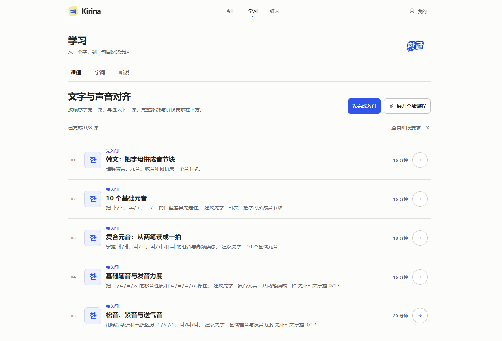
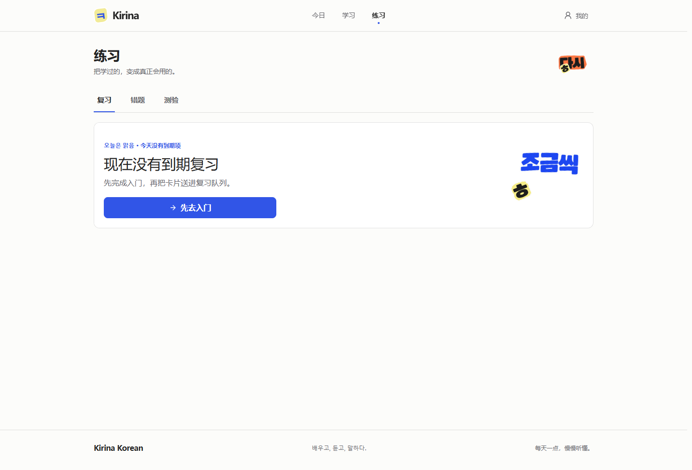

# Kirina Korean

Kirina Korean 是一个从零基础开始学习韩语的 Next.js 在线学习应用。新版采用 **韩文字碎片 × 简洁留白**：独立的单字与短词小贴片散落在页面角落，课程、词汇、听读与练习保留清晰的阅读和操作空间。

视觉提供白昼、蓝调、暖阳与夜行四种主题。系统 sans 负责正文、标题和控件，韩文细读保留 Noto Serif KR；钴蓝、柠檬黄、橙色和淡紫组成统一的贴纸色彩。


一个开始按钮、两个学习入口，韩文字贴纸在上方错落排布。

| 学习 | 练习 |
|:---:|:---:|
|  |  |
| 课程与字词、听说内容在同一个空间切换。 | 到期复习、错题与小测集中在一个空间。 |

最新产品审计：[视觉与学习体验报告](docs/product-audit-2026-09-12.md) · [优化执行计划](docs/product-optimization-plan-2026-09-12.md) · [教材与29份材料逐段核对](docs/content-task-audit-2026-09-12.md)。上一轮[工程审计](docs/audit-2026-09-11.md)保留为历史记录。截图来自生产构建的浏览器检查。

## 当前能力

- Next.js 16 + React 19 + TypeScript + Tailwind。
- Node.js `>=20.9.0`（与 Next 16 / sharp 0.35 的运行时要求一致）。
- Web App manifest 与图标位于 `public/`；课程始终联网加载，不注册 Service Worker 或离线学习包。
- 学习方式支持“路径推荐”和“自由自学”，两者共用课程进度、间隔复习、输出档案和学习记录。
- `LearningWorkspace` 会参考课程进度、自学目标、薄弱项和到期复习，推荐下一项任务，也保留自由入口。
- 课程练习、综合测验、韩文、词汇、语法、语用、情境听读和输出弱点都能加入复习；答错的题会进入错题复习。
- `Immersion Lab` 使用自编情境脚本，支持逐句播放、遮住译文听写、复述提示、输出草稿、自评和后续复习。
- 听读允许先浏览和试听，前置课程仍约束归档；输出保存会具体说明未满足条件。自然表达支持本地草稿恢复，筛选、刷新和切换栏目后可接着写。
- 课程朗读优先使用 `public/assets/audio/ko/` 中的 1212 条统一韩语 MP3；未收录的动态内容才回退到浏览器系统韩语语音。
- 图片资产通过 OpenAI ImageGen 工作流生成后接入 `public/assets/generated/`，页面通过 `src/data/visuals/assets.ts` 引用，并由 `src/data/visuals/manifest.ts` 记录 provider、prompt、源 PNG 和 WebP 派生关系。

## 命令

```bash
npm install
npm run dev
npm run validate
npm run test
npm run build
npm run speech:prepare
npm run speech:generate
npm run check
npm run lint
KIRINA_URL=http://127.0.0.1:4173 npm run smoke:http
KIRINA_URL=http://127.0.0.1:4173 npm run smoke:browser
npm run check:all
npm run check:smoke
npm run audit:prod
```

`check:smoke` 需要先执行 `npm run build`，然后会在测试进程内启动 Next production server，连续运行 HTTP 与浏览器 smoke，并在结束时关闭服务，不留下后台 Node 进程。

浏览器 smoke 需要可用的 Playwright Chromium（`npx playwright install chromium`）；如果本机使用的是全局或自定义安装，可通过 `PLAYWRIGHT_ENTRY` 指定模块。CI 会安装 Chromium 并运行生产浏览器回归，保留 `.browser-check/` 中的截图和测量结果。

发布前在 `.env` 或部署环境中配置 `NEXT_PUBLIC_SITE_URL` 为真实 HTTPS 根地址，运行 `npm run check:release`，再执行 `npm run check:all`。本地不配置时省略绝对 canonical、OG 图片和 sitemap 条目。公开模块与课程有独立标题和描述，复习、错题、测验、设置、入门工具标记为不索引。站点地址会参与静态构建，变更后必须重新构建。

## 数据与安全边界

学习进度、复习卡、草稿和作品集默认只保存在当前浏览器的 `localStorage`；录音 Blob 保存在同源 IndexedDB，不会随文字备份导出。录音可在对应课程选择“下载这段录音”。产品没有账号、服务端 API 或跨用户数据边界，因此本地数据不是可验证的认证凭据。

导入备份先验证字段类型和嵌套结构（最大 4 MB），再显示日期、课程/卡片/作品数量及缺失数据。只有最终确认后才整份替换：缺失记录和本机录音会被清理，依赖录音的课程需重新录制。取消和校验失败不改数据；写入失败尝试回滚。文字导出不是音频备份，浏览器清理数据、换域名或换设备前应分别保存。

同时打开多个页面时，复习会检测过期卡片快照并拒绝重复计分，提供“读取更新后的队列”。本地存储仍不是跨进程数据库事务；不建议在多个页面同时执行导入、重置等整库操作。

课程讲解源保留在 `src/data/lessons/`。修改课程后运行 `npm run content:prepare` 更新不含讲解卡的运行目录；`validate` 会检查生成文件是否同步。完整讲解由课程服务端页面按课传入，学习引擎使用较小的运行目录。React 工作区通过单个 Provider 共享存储订阅，课程结果和录音证据面板独立维护。`typecheck` 对全仓 TypeScript 开启 strict；`typecheck:strict` 继续单独验证学习领域边界，并以 `checkJs` 验证生成课程是否符合 `RuntimeLesson` 契约。

`check:smoke` 包含脚本体积预算、数据导入取消/替换、音频失败、跨标签页复习、分页和六档宽度回归，也检查表达草稿、三类库筛选计数、24 个产品页面布局与四主题。性能结果记录在 `.browser-check/performance.json`，DOM/布局数据记录在 `.browser-check/audit-regression.json` 与 `.browser-check/product-visual-validation.json`。这些是实验室回归，不替代真机浏览器和真实学习效果验证。本轮 13 项问题均已关闭，详见[产品优化计划](docs/product-optimization-plan-2026-09-12.md)与[最终验收数据](docs/product-validation-2026-09-12.json)；历史工程记录继续保留。

依赖升级后执行 `npm run audit:prod`；CI 使用相同的生产风险门槛。2026-09-12 同时完成生产与开发依赖修复，全量 `npm audit` 为零已知漏洞；这是一份有日期的检查结果，不能替代后续维护。

## 结构

```text
src/app/                  # Next App Router 页面
src/components/           # 布局、UI、学习组件、视觉组件
src/data/                 # 韩语课程、韩文、词汇、语法、语用、自学规划、学习进度
src/data/native-roadmap.js # 长期进阶路线蓝图
src/data/visuals/         # 视觉资产索引和 image-gen manifest
src/lib/learning/          # 学习工作台、进度、SRS、测验逻辑
  progress-normalization.ts # 本地记录归一化与证据检查
  workspace-snapshot.ts   # 学习状态、能力与推荐的只读计算
  workspace.ts            # 写入与回滚；保留原公共领域接口
  use-learning-workspace.ts # 单一 Provider 与 React 订阅
public/assets/generated/   # imagegen 生成并接入的页面资产
public/assets/audio/ko/    # 本地生成的统一韩语 MP3 与清单
tests/                     # Node 单测
scripts/validate.mjs       # 数据、应用元信息、视觉资产校验
```

## 语音资产

`npm run speech:prepare` 会从课程、练习和页面数据重新收集韩语朗读文本并生成稳定文件名；`npm run speech:generate` 默认使用本机 Sherpa-ONNX 和 `vits-mimic3-ko_KO-kss_low` 模型生成 MP3，不上传课程文本。

本地生成环境约定：

- Sherpa-ONNX 与 `lameenc` 安装在 `.tools/sherpa/`
- 公开 KSS 模型解压到 `.tools/models/vits-mimic3-ko_KO-kss_low/`
- `.tools/` 只用于本地工具并已忽略，不进入项目资产
- `scripts/validate.mjs` 会拒绝缺失、截断、格式错误或与清单不一致的音频

## 图片资产

当前页面使用 `public/assets/generated/letter-*.webp` 中的六张独立文字贴片：ㅋ、ㅎ、안녕、한글、다시、조금씩。贴片保留真实透明背景，分散在页角和标题留白处；原始 PNG 与完整生成提示词一并保留。首轮八张拼贴仅保留源资产记录，页面不再展示。

生成美学约束：每张图片仅含一个韩文字母或 2–3 字短词，准确字形、白色裁切边缘、钴蓝/柠檬黄/橙色/淡紫印刷色。不加入生活场景、物件、整幅拼贴、假透明棋盘格或水印。详见 `design/scattered-fragments.md`。

导航收敛为「今日、学习、练习」，首页只有一个学习动作、两个文字入口，以及点缀留白的小韩文字贴片。学习空间集成课程、字词、听说，练习空间集成复习、错题和测验；个人空间集中偏好、计划、记录、外观和数据工具。栏目支持刷新与浏览历史，旧课程和材料链接继续有效。详见 `design/quiet-learning-spaces.md`。

每张资产都需要：

- `public/assets/generated/*.png` 源图
- `public/assets/generated/*.webp` 页面展示图
- `src/data/visuals/assets.ts` 页面引用
- `src/data/visuals/manifest.ts` 生成来源和 prompt 记录
- `scripts/validate.mjs` 校验通过

## 内容规模与路线

当前内容规模：60 节主线课、722 个词、83 个语法点、20 个语用场景、12 组近义表达和 29 组自编情境听读材料。它适合从零基础逐步进入中级内容，但没有经过正式的 CEFR 定级，也不代表学完就达到母语者水平。

长期进阶路线由 `src/data/native-roadmap.js` 维护，规划包括：

- 5000+ 可调用词汇与搭配
- 200+ 分级原生材料
- 120+ 口语/写作输出档案
- 24+ 阶段检查点
- 新闻、职场、学术、社交媒体、亲密关系、敬语、口语缩略、幽默、暗示、反讽和立场边界训练

原则：站内分数只用于反馈当前学习情况，不能当作语言等级证书。若要判断长期能力，还需要结合原生材料、口语和写作作品、复习记录以及阶段检查。
