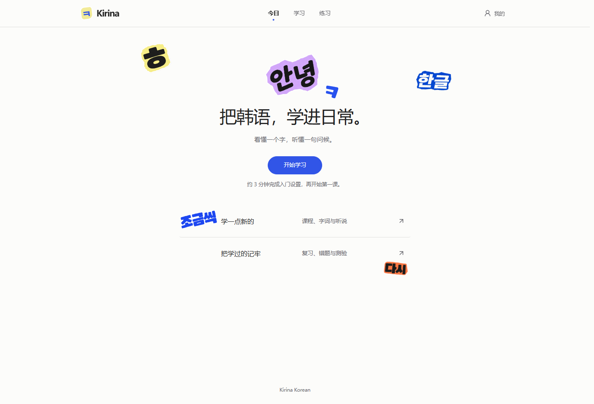

# Kirina Korean 产品与学习体验审计 · 2026-09-12

## 结论

本轮发现的 **13 项问题已全部修复并通过验收：2 项 P1、10 项 P2、1 项 P3**。修复覆盖视觉一致性、内容出现顺序、筛选与草稿、听读流程和教材准确性。414 项测试、117 条 HTTP 路由以及生产构建的浏览器回归全部通过。

修复前的主要矛盾是：入口看起来简洁，进入学习后却出现多层标题、重复说明、过多预先展开的控件；教材规模较大，部分补充讲解和听读问题仍有错误。本轮采用“当前任务优先、次要内容按需展开、输入可靠保存”的方案。上一轮工程审计已关闭的问题不重复计入本轮。

本轮从当前未提交的工作区出发，采用源码审查、内容核对、独立浏览器操作和桌面/手机截图。代码基线为 `bcc2ce9` 加此前重设计与工程修复。**以下“主要缺口”和问题表记录修复前发现；末尾记录实际处理结果。** 已保留此前的工作区改动。

## 覆盖范围与边界

- 视觉：主页、课程、韩文、词汇、语法、听读、表达、复习、错题、测验、个人空间；检查布局、字号、层级、贴纸位置和主题一致性。
- 操作：首次学习、栏目切换、筛选与分页、展开收起、草稿恢复、音频预览、输出反馈、归档；关注键盘、手机和空状态。
- 内容：60 课的教材组织及重点讲解，722 词、83 语法点的结构与发现路径，29 段材料的题目与原文可回答性，以及 32 个语用/细差表达。
- 工程：已有严格类型、内容生成、持久化、测试、构建和浏览器验证继续作为回归门槛，不以视觉改动破坏学习证据。
- 未进行真实学习者实验、全量音频人工听审或逐词母语教师审校；本报告不能证明教学效果或认证语言水平。美感评价为结合用户明确偏好的设计评审，布局测量与流程复现属于客观证据。

## 各维度判断

| 维度 | 已有基础 | 本轮主要缺口 |
|---|---|---|
| 视觉完整度 | 白纸、钴蓝、韩文字片已形成辨识度；不再依赖整张场景图 | 首页与内页品牌大小、宽度和选中态不同；内页装饰与大标题占位偏大 |
| 前端体验 | 三项主导航、URL 栏目、错误恢复、可继续学习 | 内容出现太晚；听读任务顺序与最终操作位置不连贯 |
| 极简性 | 顶层入口已收敛，部分筛选已折叠 | 表达页全部筛选、六张完整练习和长线目标同时展开；课程说明层级重复 |
| 操作友好度 | 统一按钮、焦点、输入标签、筛选键盘操作 | 草稿因筛选卸载丢失；筛选数量误导；按钮禁用原因不具体 |
| 内容合理性 | 分阶段课程、例句、听写、复述和语域任务齐全 | 补充教材事实错误；部分复述要求没有原文依据 |
| 内容丰富性 | 词汇、语法、材料和表达总量足够形成入门主线 | 听读全部原文被课程门槛封锁；丰富内容难以发现，继续增加数量不是首要任务 |
| 工程质量 | 统一 workspace 写入，严格类型，410 项已有测试 | 新增交互需沿用草稿与备份体系；数据生成物必须与作者源同步 |

## 问题与处理方案

| ID / 优先级 | 可复现的问题与证据 | 改进与验收 |
|---|---|---|
| P01 / P2 | `studio-intro.tsx` 与 `globals.css`：内页大标题/标语/140px 装饰叠在导航前；首页专用品牌、宽度、选中态使切页时界面跳变；词汇/语法的搜索标题、总数、分页、分组统计多次重复 | 统一页头，把工作区标题压缩为轻量导语；库页面去重复说明，顶部简短分页、底部完整分页；390px 与桌面截图核对，导航保持稳定，常用触控入口至少44px |
| P02 / P2 | `path/page.tsx`：总路线介绍→阶段总览→当前阶段说明→阶段标题→进度条之后才出现课程；手机第一屏仍在说明区 | 当前阶段直接呈现，阶段进度细节按需展开，保留全路线与前置原因；手机首屏可见第一课 |
| P03 / P3 | `page.tsx`：首页“3 分钟，从第一句开始”实际进入设备/目标/键盘设置；返回用户主要操作只有“继续学习”，具体任务藏在弱提示 | 明确入门设置耗时与之后的学习；返回用户呈现当前推荐任务，保持单一主操作和开放目录；贴纸围绕内容形成非对称构图 |
| P04 / P2 | `native/page.tsx`：390×844 第一张卡 y≈1351，默认页高 13338px；六张卡全部展开、筛选全开，标题在筛选后仍固定“6 个”；正则推断标签将“第一次见面”误标为“服务场景/确认请求” | 折叠次要筛选/长线资料，默认打开首卡，标题/显示数量随模式变化；删除错误推断标签并保留作者说明；首卡进入手机第一屏，所有内容仍可找到 |
| P05 / P2 | 三个词汇/语法/表达库的 facet 计数来自已经应用自身条件的结果；语法选基础后其他层级显示 0，点击却有 41 项 | 计算每一条件自身未应用时的可选数量，其他条件保留；多条件交叉筛选与重置验证 |
| P06 / P1 | `NativeCard` 复述/关系改写只在组件 state：输入→搜索无结果→清搜索，草稿消失；刷新或切栏目亦然 | 接入现有持久化草稿、恢复和失败提示；验证筛选卸载/重载/刷新/备份及成功提交后的语义 |
| P07 / P1 | 教材 `extra.js` 将 ㄱ+ㅏ+ㄴ 写成 한，双收音列表漏 ㄽ；`depth.js` 将 ㄹ 概括为词中 l；`completions.js` 将 만들어요 当形容词 | 修正构字、完整双收音、位置发音和词性，同步生成运行时并补充内容回归 |
| P08 / P2 | `materials.ts`：购物原文只有 이것만 却问买了多少；无 speaker 的群聊问题要求判断“谁”；银行转账与商户付款场景无过渡 | 核对 29 段的任务可回答性，问题改为原文有依据的信息；说明场景边界，保持音频文本一致 |
| P09 / P2 | `immersion/page.tsx` 将全部 29 段原文与试听和完成门槛一起封锁；第一份材料前置链含第 20 课 | 开放阅读/试听探索，清楚区分预览和归档要求；预览不得写入掌握/完成证据 |
| P10 / P2 | `evidence.ts` 输出要求字数、不同词数、句数、弱点和改写长度；UI 只有禁用按钮，不能知道缺项 | 共用结构化验证结果，就地显示未满足条件；说明结构检查不等于语义正确，保留原完成标准 |
| P11 / P2 | 听读标题重复；“下一步”使用“已完成”式标签；五门槛挤成四列；最终完成按钮在后续输出之前 | 合并材料标题，动作式步骤导航，直达未完成任务；最终归档置于自检/输出之后，手机与键盘操作验证 |
| P12 / P2 | `hangul/page.tsx`：六个拼字样例全部展开在字母库之前；五组字母、十组对比和七条音变共处长页，没有主题直达 | 用六个可试听的音节按钮切换构字说明；增加折叠的页内目录，直达字母组/辨析/音变，不隐藏已有学习项目 |
| P13 / P2 | 最终逐页截图发现错题新手空态仍展示四个全零统计、多次重复标题及四个操作；测验空态嵌套两个面板，装饰和重复模块说明占满手机屏幕 | 对齐复习空态：新手只保留一个说明和可执行入口；真实题目/错题存在时保留原工具、统计和流程；手机空态装饰不单独撑高 |

## 修复前浏览器证据

使用独立 context，没有清理用户页面的学习数据。截图和测量保存在 `.browser-check/product-before-*.png` 与 `.browser-check/product-before.json`，包括 390×844、1440×980 的首页、课程、词汇、表达、听读和复习。测量时排除浏览器外框；关闭的 details 中的子元素不应作为可见学习内容统计。

代表性复现：表达页首卡绝对 y≈1351；词汇层级标题 y≈878（手机）；听读的真正逐句听读标题 y≈1739（手机）。这些距离说明“首屏没有溢出”不足以证明学习体验良好。

## 语言依据

构字、双收音与 ㄹ 的发音按国立国语院规范与官方教材核对；区分音节书写、音位位置及实际语音，不使用中文谐音代替说明。[国立国语院《标准发音法》](https://www.korean.go.kr/kornorms/m/m_regltn.do?regltn_code=0002)。本轮不扩大为对所有学习素材自然度的认证。

## 最终验收

### 修复结果与证据

| 问题 | 最终结果 | 主要实现与验证 |
|---|---|---|
| P01 | 已完成。所有整合栏目共用页头尺寸、位置、宽度与选中态；缩短工作区导语和装饰占位；词汇、语法去掉重复统计与标题 | `studio-intro.tsx`、`globals.css`、`library-pagination.tsx`；12 个页面 × 2 个宽度逐一比较页头坐标，并检查首项内容位置 |
| P02 | 已完成。打开课程直接看到当前阶段和前六课；完整 60 课、五阶段目录及阶段要求按需展开 | `path/page.tsx`；展开全部、选择阶段及焦点回到课程列表均实测 |
| P03 | 已完成。首页说明“约 3 分钟完成入门设置，再开始第一课”；返回用户显示具体推荐任务；保留一个主动作与两个文字目录 | `page.tsx`；首次与返回用户流程、桌面手机截图、四主题检查 |
| P04 | 已完成。表达页默认只展开第一项；筛选、方法及长线资料折叠；全部 32 项仍可找到；删除没有作者依据的推断标签 | `native/page.tsx`；默认六项、全量展开、搜索、筛选及重新打开练习均通过 |
| P05 | 已完成。三类库的每个筛选条件显示真实可选数量，其他已选条件继续生效 | 语法基础 22 / 连续表达 41 / 进阶 20；词汇 253 / 338 / 131；表达 9 / 12 / 11；键盘选择及计数回归通过 |
| P06 | 已完成。复述和关系改写随输入保存；筛选、刷新、切页可恢复；写入失败保留当前文字并提供重试 | `drafts.ts`、`backup-schema.ts`、`native/page.tsx`；沿用原草稿键，兼容旧备份；正式提交清草稿，草稿不计学习证据 |
| P07 | 已完成。修正韩文字母/音节块描述、构字、十一双收音、ㄹ 位置发音、连音适用边界和形容词例子 | 作者源和 `runtime.generated.js` 同步；正文构字负例及双收音完整性测试通过；见[内容附录](content-task-audit-2026-09-12.md) |
| P08 | 已完成。逐段核对 29 份材料及 87 个复述提示，修正 7 份材料的问题或情境说明，另将 3 条教学提示改成中文 | 材料 ID、前置关系和韩语音频文本保留；逐段判定表及官方依据见内容附录 |
| P09 | 已完成。29 份听读原文与音频可先探索；前置课仍约束输出归档和正式完成 | 新手预览可用、正式归档被正确拦截；预览与草稿不产生 SRS / 掌握记录 |
| P10 | 已完成。输出表单逐项说明结构要求和缺项；UI 与保存逻辑使用同一验证结果 | `evidence.ts` 和听读表单；字数、词数、句子、改写、自评等边界测试；未降低原有标准 |
| P11 | 已完成。听读只保留一个材料主标题；五个动作步骤可键盘直达；最终归档位于输出之后 | 320 / 390 / 768 / 1440px 实测；五步骤焦点目标、试听、反馈、前置与归档检查通过 |
| P12 | 已完成。六个音节按钮切换试听与构字说明，七个主题锚点直达字母组、辨析和音变 | 保留 47 个字母项目、10 组对比及 7 条音变；切换 한、展开目录、跳转音变通过 |
| P13 | 已完成。新手复习、错题、测验均只保留一个说明与一个可执行入口 | 移除空态零值统计、重复模块标题及嵌套面板；有学习内容时仍显示原工具；三个空态均为 844px 手机页高 |

### 视觉检查与实测结果

对生产页面截图进行了人工查看，并用独立浏览器补查移动端、桌面端及键盘操作。人工评审关注贴片与文字是否相互遮挡、视觉重点是否集中、第一项学习内容出现的位置、空态是否重复；自动检查覆盖页宽、坐标、触控尺寸、路由和浏览器异常。没有把“构建成功”当作视觉合格的依据。

下表来自 390×844 的独立新用户浏览器。y 为距离页面顶部的 CSS 像素；对比测量仅用于同一页面/元素，不能把不同标题的位置当成同一指标。

| 指标 | 修复前 | 修复后 | 含义 |
|---|---:|---:|---|
| 表达页默认总高度 | 13,338px | 2,677px | 降低约 80%，全部内容仍可按需展开 |
| 表达页首卡顶部 | 约 1,351px | 696px | 手机初始视口可见首项 |
| 课程页默认总高度 | 2,234px | 1,679px | 当前课排在完整路线前面 |
| 第一课顶部 | — | 455px | 初始视口能看到课程与操作 |
| 第一词条 / 语法项顶部 | — | 721px / 689px | 搜索之后直接进入内容 |
| 韩文拼字练习按钮顶部 | — | 542px | 字母库之前已有可操作的学习内容 |
| 新手复习 / 错题 / 测验页高度 | — | 均为 844px | 空态说明和下一步均位于一屏内 |

新版首页与学习页：

| 课程：修复前 | 课程：修复后 | 表达：修复前 | 表达：修复后 |
|---|---|---|---|
|  |  |  |  |

首页保持韩文字片的非对称排布，内容页降低装饰比重。白昼、蓝调、暖阳、夜行四个主题完成检查；夜间另以真实保存的主题偏好刷新验证。以下是听读与新手空态的最终截图：

| 听读 | 错题新手空态 |
|---|---|
|  |  |

### 学习路线与内容的最终判断

60 课的分阶段主线，以及词汇、语法、听读、表达、复习之间的关系应继续保留。课程为初学者提供顺序，资料库允许查询和探索，听读与自由输出提供应用场景，到期复习与错题提供回访。现在课程页优先呈现当前阶段，资料库用搜索和真实筛选数量帮助发现内容，浏览材料不再要求先通过整条前置链。

“看过”“写过草稿”和“完成学习”继续分开：预览不授予完成记录；自评和机器结构检查不能证明韩语语义正确；正式学习证据仍由原有门槛约束。输出验证新增具体反馈，是为了让学习者知道如何继续，不是把字符数量等同于语言能力。

内容数量已足以支撑现有入门主线，本轮优先修复错误和任务可回答性，没有用新增大量词条掩盖质量问题。长期路线中的 5,000+ 词汇、200+ 原生材料等是规划目标，不能作为目前已交付内容宣传。自编情境听读与真实自然语料的区别、合成音频与母语自然语音的区别应继续明确。

### 工程与操作验收

| 检查 | 最终结果 |
|---|---|
| `npm run check` | 通过：内容校验、零警告 lint、严格 TypeScript / 内容 JS 契约、414 / 414 测试、生产构建 |
| 内容同步 | 60 课、722 词、83 语法点、5 组韩文、29 份材料；作者源与生成运行时一致 |
| 生产构建 | 79 个静态页面生成成功 |
| `npm run check:smoke` | 通过：117 条 HTTP 路由与完整浏览器 smoke |
| 综合交互 | 返回用户、路径/自学切换、计划/检查点保存、栏目导航、到期复习通过 |
| 数据与恢复 | 备份畸形输入/预览/取消/确认/录音清理，跨标签页重复复习保护，音频真实加载失败，懒加载失败重试，404 状态通过 |
| 新增专项 | 表达草稿恢复与写入失败重试；三类筛选计数及键盘操作；24 个页面布局；四主题；韩文目录与拼字通过 |
| 响应式范围 | 原有综合回归覆盖 320、390、768、1024、1280、1440px；新增完整页面截图为 390×844 和 1440×980 |
| 生产依赖审计 | `npm audit --omit=dev`：当日已知漏洞 0 |
| JS 体积预算 | 最大单块 598,203 B，gzip 195,326 B；低于 650,000 / 220,000 B 门槛 |

所有分块原始总和为 2,534,306 B；这是构建产物总和，不是每条路由的下载量，也不是实测 Core Web Vitals。原始日志位于 `.browser-check/product-check-final.log`、`.browser-check/product-smoke-final.log`；可提交的汇总见 [验收数据](product-validation-2026-09-12.json)。浏览器测试使用独立上下文，未重置用户实际页面的进度。

### 仍需外部验证的产品边界

本轮 13 项可复现问题已关闭。以下不冒充已完成的验证，也不是遗留的软件修复步骤：

| 后续验证 | 建议方法与判断依据 |
|---|---|
| 真实学习者是否找得到下一步 | 分别邀请零基础与已有基础学习者完成入门、找课、试听、写草稿、恢复草稿及复习；记录误点、求助、放弃位置，再调整文案与顺序 |
| 内容自然度与语域 | 由韩语母语教师逐条审校词条、例句和自由表达反馈，记录适用关系、场景和可接受变体；目前未完成 722 词的逐条教师签核 |
| 音频与实际开口能力 | 人工听审合成音频的发音和韵律，并对真实口语/写作作品做外部评价；播放器成功播放不能证明学习者听懂 |
| 长期难度与路线效果 | 用延迟复习、迁移任务及阶段作品观察真实学习结果；不以站内分数或完成率宣称 CEFR 等级或母语水平 |
| 真机与性能 | 在低性能手机、系统字体放大和真实网络下检查输入、录音、语音权限、滚动和交互延迟；本轮 Chromium 实验室检查不能替代全部设备 |

详细实施顺序、文件和验收规则见 [已完成的产品优化计划](product-optimization-plan-2026-09-12.md)。
